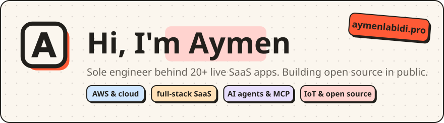
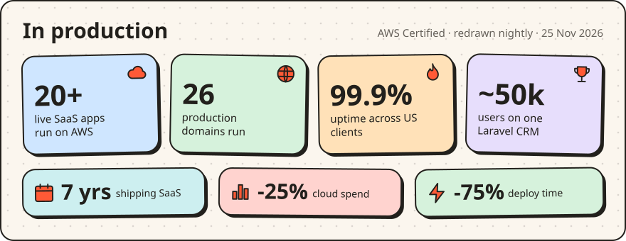
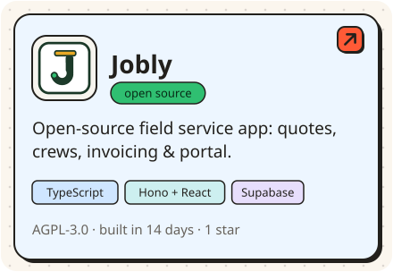
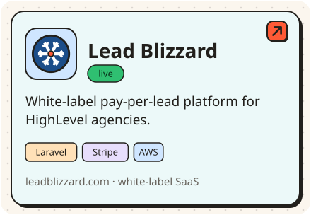
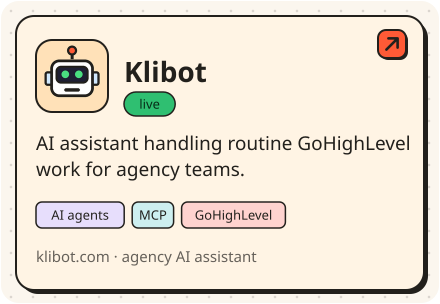
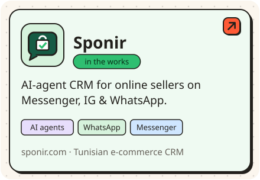
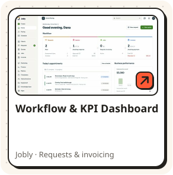
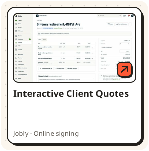
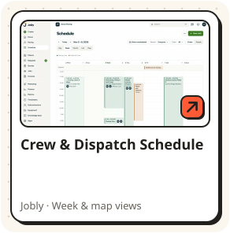

<a href="https://aymenlabidi.pro"><picture><source media="(prefers-color-scheme: dark) and (max-width: 600px)" srcset="assets/hero-phone-dark.svg"><source media="(max-width: 600px)" srcset="assets/hero-phone-light.svg"><source media="(prefers-color-scheme: dark)" srcset="assets/hero-dark.svg"></picture></a>

<a href="https://www.linkedin.com/in/aymen-labidi-b91a40102/"><picture><source media="(prefers-color-scheme: dark)" srcset="assets/badge-li-dark.svg"></picture></a>
<a href="https://github.com/aymenoppa/jobly"><picture><source media="(prefers-color-scheme: dark)" srcset="assets/badge-jobly-dark.svg"></picture></a>
<a href="mailto:contact@aymenlabidi.pro"><picture><source media="(prefers-color-scheme: dark)" srcset="assets/badge-mail-dark.svg"></picture></a>
<a href="https://aymenlabidi.pro"><picture><source media="(prefers-color-scheme: dark)" srcset="assets/badge-site-dark.svg"></picture></a>

<picture><source media="(prefers-color-scheme: dark) and (max-width: 600px)" srcset="assets/stats-phone-dark.svg"><source media="(max-width: 600px)" srcset="assets/stats-phone-light.svg"><source media="(prefers-color-scheme: dark)" srcset="assets/stats-dark.svg"></picture>

<picture><source media="(prefers-color-scheme: dark) and (max-width: 600px)" srcset="assets/whoami-phone-dark.svg"><source media="(max-width: 600px)" srcset="assets/whoami-phone-light.svg"><source media="(prefers-color-scheme: dark)" srcset="assets/whoami-dark.svg"></picture>

<picture><source media="(prefers-color-scheme: dark) and (max-width: 600px)" srcset="assets/label-ship-phone-dark.svg"><source media="(max-width: 600px)" srcset="assets/label-ship-phone-light.svg"><source media="(prefers-color-scheme: dark)" srcset="assets/label-ship-dark.svg"></picture>

<a href="https://github.com/aymenoppa/jobly"><picture><source media="(prefers-color-scheme: dark) and (max-width: 600px)" srcset="assets/app-jobly-phone-dark.svg"><source media="(max-width: 600px)" srcset="assets/app-jobly-phone-light.svg"><source media="(prefers-color-scheme: dark)" srcset="assets/app-jobly-dark.svg"></picture></a>
<a href="https://leadblizzard.com"><picture><source media="(prefers-color-scheme: dark) and (max-width: 600px)" srcset="assets/app-leadblizzard-phone-dark.svg"><source media="(max-width: 600px)" srcset="assets/app-leadblizzard-phone-light.svg"><source media="(prefers-color-scheme: dark)" srcset="assets/app-leadblizzard-dark.svg"></picture></a>
<a href="https://klibot.com"><picture><source media="(prefers-color-scheme: dark) and (max-width: 600px)" srcset="assets/app-klibot-phone-dark.svg"><source media="(max-width: 600px)" srcset="assets/app-klibot-phone-light.svg"><source media="(prefers-color-scheme: dark)" srcset="assets/app-klibot-dark.svg"></picture></a>
<a href="https://sponir.com"><picture><source media="(prefers-color-scheme: dark) and (max-width: 600px)" srcset="assets/app-sponir-phone-dark.svg"><source media="(max-width: 600px)" srcset="assets/app-sponir-phone-light.svg"><source media="(prefers-color-scheme: dark)" srcset="assets/app-sponir-dark.svg"></picture></a>

Also building: <a href="https://ownmycrm.com">OwnMyCRM</a> (AI-agent-ready CRM) · <a href="https://aymenlabidi.pro">GetGroupLeads</a> (~50k users) · <a href="https://aymenlabidi.pro">Vision Aid AI Glasses</a> · <a href="https://aymenlabidi.pro">Drone Detection</a> · <a href="https://aymenlabidi.pro">Bionic Butterfly (ESP32)</a>

<picture><source media="(prefers-color-scheme: dark) and (max-width: 600px)" srcset="assets/label-showcase-phone-dark.svg"><source media="(max-width: 600px)" srcset="assets/label-showcase-phone-light.svg"><source media="(prefers-color-scheme: dark)" srcset="assets/label-showcase-dark.svg"></picture>

<a href="https://github.com/aymenoppa/jobly"><picture><source media="(prefers-color-scheme: dark) and (max-width: 600px)" srcset="assets/showcase-dashboard-phone-dark.svg"><source media="(max-width: 600px)" srcset="assets/showcase-dashboard-phone-light.svg"><source media="(prefers-color-scheme: dark)" srcset="assets/showcase-dashboard-dark.svg"></picture></a>
<a href="https://github.com/aymenoppa/jobly"><picture><source media="(prefers-color-scheme: dark) and (max-width: 600px)" srcset="assets/showcase-quote-phone-dark.svg"><source media="(max-width: 600px)" srcset="assets/showcase-quote-phone-light.svg"><source media="(prefers-color-scheme: dark)" srcset="assets/showcase-quote-dark.svg"></picture></a>
<a href="https://github.com/aymenoppa/jobly"><picture><source media="(prefers-color-scheme: dark) and (max-width: 600px)" srcset="assets/showcase-schedule-phone-dark.svg"><source media="(max-width: 600px)" srcset="assets/showcase-schedule-phone-light.svg"><source media="(prefers-color-scheme: dark)" srcset="assets/showcase-schedule-dark.svg"></picture></a>

Sticker-board layout inspired by <a href="https://github.com/ZazaGdev">ZazaGdev</a> · refreshed every night by a GitHub Action · <a href="https://aymenlabidi.pro">aymenlabidi.pro</a>

